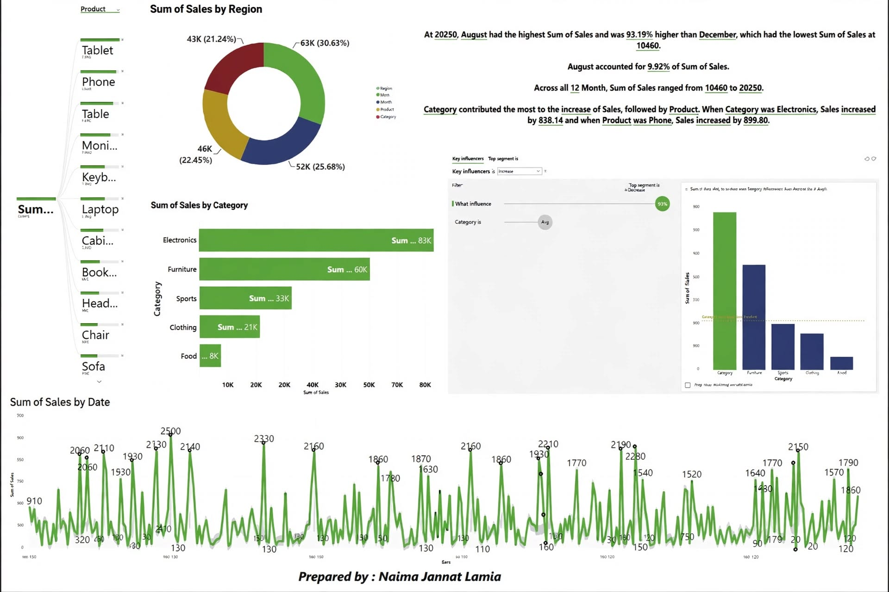

# Power BI Electronics Sales AI Dashboard

An AI-driven Power BI dashboard analyzing electronics sales by category and date to find what drives sales and when sales peak.

## Tools
Power BI, DAX, Power Query, Key Influencers visual, Decomposition Tree

## Key Findings
- Electronics (+938) and Phones (+889) are the key influencers of sales
- Peak sales month: August 2024 (20,250 units)
- Date-wise trends highlight seasonality in sales

## Dashboard Preview

